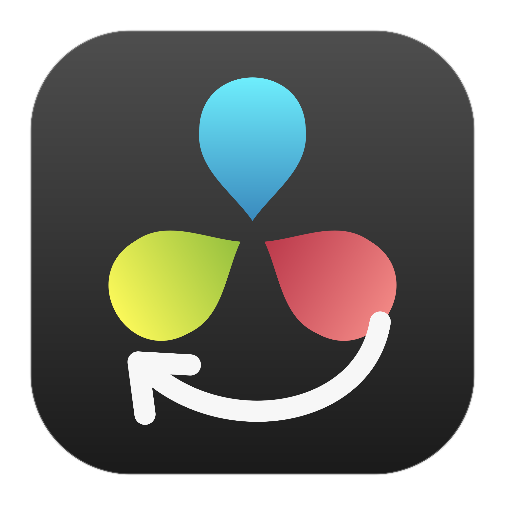

# DaVinci Resolve Compat

[简体中文](README.md) | English



An unofficial tool for creating project copies that older versions of DaVinci Resolve may be able to open. It includes a bilingual macOS app and a Python command-line tool. Conversion runs locally and preserves the original project.

## Download and use

Download the DMG from [GitHub Releases](https://github.com/Jzero1992/davinci-resolve-compat/releases). The app supports Apple silicon Macs running macOS 12 or later and includes its own Python runtime. The release is ad hoc signed and has not been notarized. The DMG includes first-launch instructions in both languages.

1. Drag the app into Applications and open it.
2. Choose **English** or **简体中文** from the **Language / 语言** menu. The app remembers your choice.
3. Choose or drop a `.drp` project or `.dra` archive. Select **Auto** or a target version.
4. Click **Create Compatibility Copy** and import the output in the target Resolve version.

The app saves the copy beside the source by default. You can change the output location. If a name is already in use, the app appends a number. A `.dra` input produces a `.drp` without copying media. If media is offline, relink it from the original archive’s `MediaFiles` folder.

## Compatibility

| Source | Target | Project version markers | Validation |
| --- | --- | --- | --- |
| Resolve 21 | Resolve 20 | 17 → 15 | Local samples imported, opened, and saved in 20.3.3 |
| Resolve 20 | Resolve 19 | 15 → 14 | A simple audio/video sample imported, opened, and saved in 19.1.4 |
| Resolve 21 | Resolve 19 | 17 → 14 | Experimental manual option |

Auto selects the next older major version. The tool patches XML version markers and repackages the archive. Project data structures stay in their original format, so check effects, Fusion, subtitles, grades, and audio in the target version. The app checks archive integrity. Opening and reviewing the result in Resolve is a separate step.

## Command line and tests

The CLI uses Python 3.10 or later and the standard library. Existing output files are protected against overwrite. The accompanying JSON report records checksums, changed archive members, and the target. Remove private paths before sharing a report.

```sh
python3 resolve_compat.py "/path/to/project.drp"
python3 resolve_compat.py "/path/to/archive.dra" --target 19
python3 -m unittest discover -v
```

## Build the Mac app

Use an Apple silicon Mac with Xcode or Apple Swift build tools, Python 3, and network access. The build downloads a pinned Python runtime and checks its SHA-256 before bundling it.

```sh
git clone https://github.com/Jzero1992/davinci-resolve-compat.git
cd davinci-resolve-compat
./gui/build.sh

python3 -m venv .venv
.venv/bin/python -m pip install --target distribution/build-deps -r requirements-build.txt
.venv/bin/python gui/build_dmg.py
```

Find the DMG in `distribution/releases/`.

## License

Copyright © 2026 J.zero. The original code is available under the [MIT License](LICENSE). See [third-party notices](THIRD_PARTY_NOTICES.md) for bundled components and trademarks. This is an independent project and has no affiliation with Blackmagic Design.
