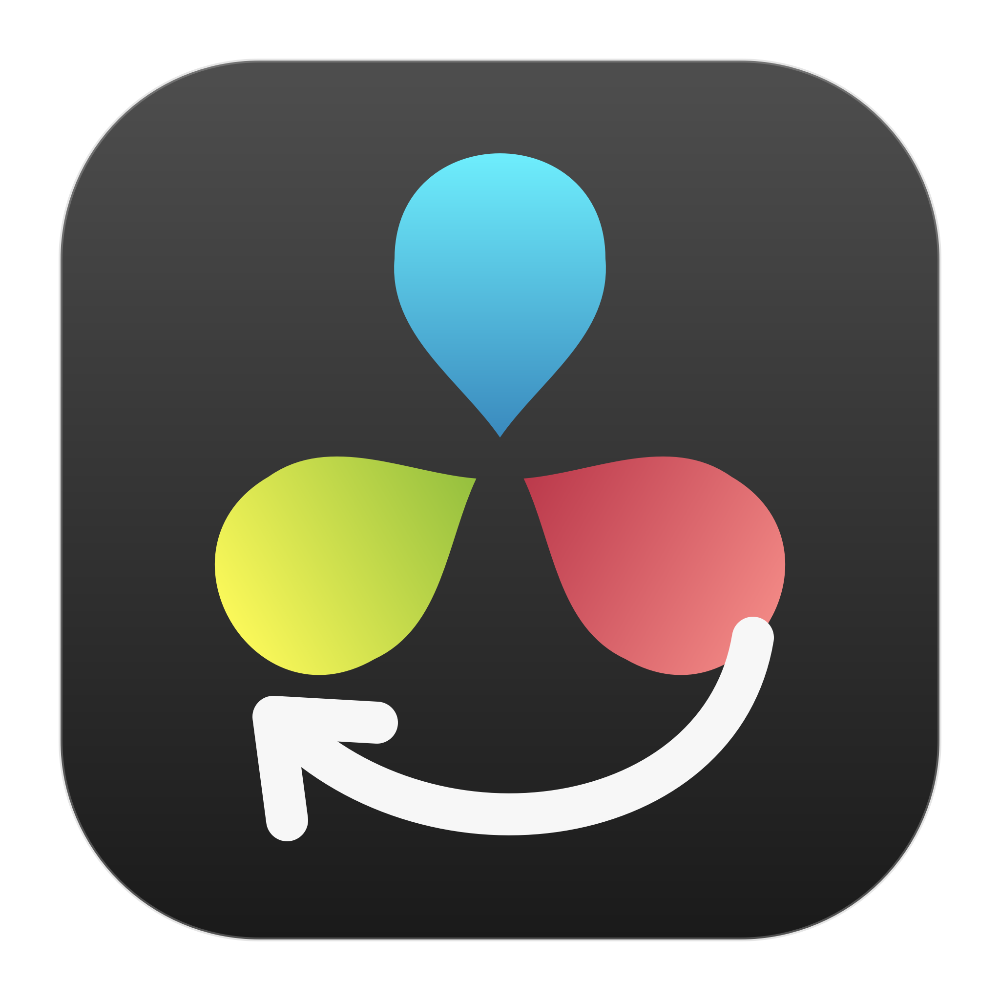

# DaVinci Resolve Compat · 达芬奇工程兼容工具

简体中文 | [English](README.en.md)



尝试让较新版 DaVinci Resolve 工程在旧版中打开的本地工具，提供中文 macOS 界面与 Python 命令行。

**这是工程版本标记补丁，不是完整格式转换器。** 它不会迁移新版数据结构，也不能保证特效、Fusion、字幕、调色或音频设置在旧版中一致。

## 下载与使用

在 [Releases](https://github.com/Jzero1992/davinci-resolve-compat/releases) 下载 DMG。

- 图形界面发行版：**Apple 芯片 Mac，macOS 12 及以上**；不支持 Intel Mac 或 Windows GUI。
- 已内置 Python，使用者无需另装 Python、Xcode 或命令行工具。
- 打开 DMG，把 App 拖入“应用程序”。DMG 提供首次打开被系统拦截时的提示。
- 发行版为本地临时签名，尚未经过 Apple Developer ID 签名和公证。

通过菜单栏的 **语言 / Language** 切换简体中文和英文，应用会记住选择。

选择或拖入 `.drp` / `.dra`，选择自动识别或目标版本，点击“生成兼容副本”。副本默认位于原工程旁，可更改位置；GUI 对同名文件自动编号。

`.dra` 输入只输出轻量 `.drp`，不复制素材。素材离线时请重新链接原归档里的 `MediaFiles`。

## 兼容范围

| 源版本 | 目标版本 | 内部工程版本 | 验证状态 |
| --- | --- | --- | --- |
| Resolve 21 | Resolve 20 | 17 → 15 | 本地样本在 20.3.3 导入、打开并保存成功 |
| Resolve 20 | Resolve 19 | 15 → 14 | 简单音视频样本在 19.1.4 导入、打开并保存成功 |
| Resolve 21 | Resolve 19 | 17 → 14 | 手动实验选项，未完成实际应用验证 |

自动模式只降一级。目标必须比源版本低；不支持任意版本降级。识别依据为内部工程版本，而非文件名。

上述验证没有覆盖所有功能、完整播放、完整渲染或逐帧视觉等价性。输出报告的 `verified_in_resolve` 默认为 `false`；工具自身不会控制 Resolve 或自动验证输出。

## 命令行

Python 3.10+，无第三方依赖。CLI 可在安装了 Python 的 macOS、Linux、Windows 上运行；实际 Resolve 兼容性仅有上述 macOS 样本验证。

```sh
python3 resolve_compat.py "/path/to/project.drp"
python3 resolve_compat.py "/path/to/archive.dra" --target 19
python3 resolve_compat.py "/path/to/project.drp" --target 20 -o "/path/to/copy.drp"
```

CLI 遇到已有输出会拒绝覆盖。`.report.json` 记录输入/输出 SHA256、修改的成员、目标版本及实验状态。报告含本地路径，提交 issue 时请先删去不想公开的信息。

## 工作原理

检查 ZIP 完整性与内部版本，修改 XML 的 `DbPrjVer`、`DbAppVer` 和主工程 `ProjectVersion` 标记，保留其他内容，重新打包并校验，另存副本并记录哈希。

不解压、执行或上传工程内容。请保留原工程，并在目标版本中检查副本。

## 测试

```sh
python3 -m unittest discover -v
```

测试使用程序生成的最小 ZIP 样本，覆盖版本映射、原文件及非目标内容保留、禁止覆盖、中文路径、归档旁输出，以及不支持硬链接的卷。它们不是 Resolve 运行时兼容性测试。仓库不含真实用户工程或媒体。

## 从源码构建 macOS App

需要 Apple 芯片 Mac、Xcode / Apple Swift 编译器、构建机上的 Python 3 和网络连接。这些要求只适用于构建者。

```sh
git clone https://github.com/Jzero1992/davinci-resolve-compat.git
cd davinci-resolve-compat
./gui/build.sh
```

构建脚本下载固定的 [Python Build Standalone 20261026](https://github.com/astral-sh/python-build-standalone/releases/tag/20261026)（Python 3.12.16），校验内置 SHA256 后嵌入 App。首次约下载 24 MB，缓存位于被 Git 忽略的 `distribution/runtime-source/`。输出为 `达芬奇工程兼容工具.app`。

App 使用内置解释器的隔离模式，不依赖使用者的系统 Python。运行时许可证随 App 保留。所有二进制使用临时签名；仓库没有开发者证书或公证凭据。

### 构建 DMG

```sh
python3 -m venv .venv
.venv/bin/python -m pip install --target distribution/build-deps -r requirements-build.txt
.venv/bin/python gui/build_dmg.py
```

输出在 `distribution/releases/`，脚本拒绝覆盖已有同名 DMG。背景嵌入 App，避免显示隐藏文件时出现额外根目录资源；Finder 布局写入 `.DS_Store`。

## 源码结构

- `resolve_compat.py`：转换引擎与 CLI。
- `gui/main.swift`、`gui/worker.py`：AppKit 界面与 JSON 子进程接口。
- `gui/prepare_runtime.py`、`gui/bundle_runtime.py`：下载、校验、嵌入运行时及签名。
- `gui/build.sh`、`gui/build_dmg.py`：App / DMG 打包。
- `gui/draw_icon.swift`、`gui/draw_dmg.swift`：图标和背景绘制源码。

## 许可证

Copyright © 2026 Jzero. 原创源码采用 [MIT License](LICENSE)。第三方组件保留各自许可证，见 [THIRD_PARTY_NOTICES.md](THIRD_PARTY_NOTICES.md)。

本工具是独立社区项目，与 Blackmagic Design 没有隶属关系。DaVinci Resolve 等商标归各自权利人所有。
